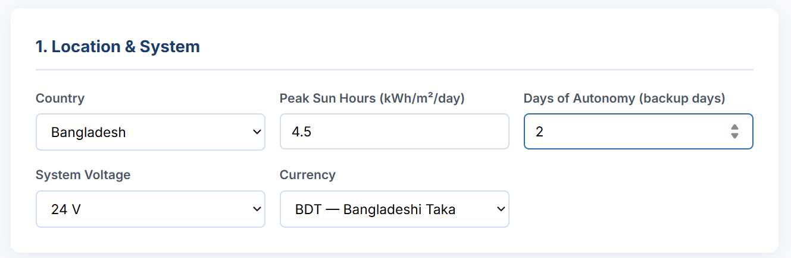
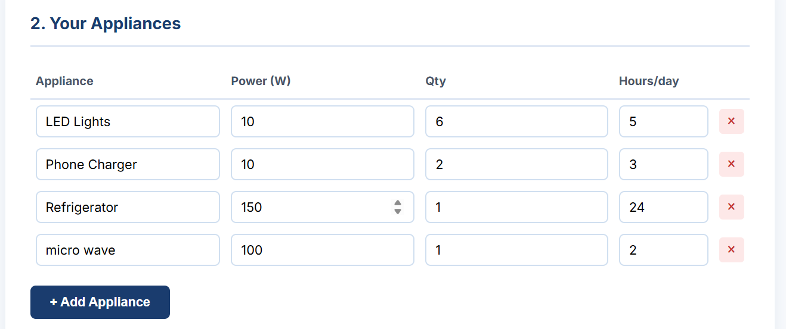
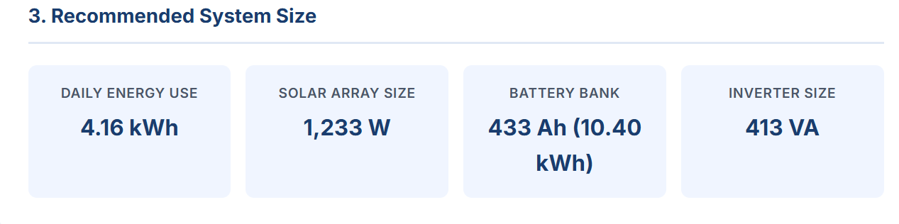

\# ☀️ Solar Budget Calculator


A free, browser-based tool that sizes a solar power system and estimates its cost — for any country, in any currency.


\*\*No install. No signup. Works offline.\*\*


---


\## What It Does


You enter three things:


1\. \*\*Where you are\*\* — country (auto-sets peak sun hours and currency)

2\. \*\*What you want to power\*\* — appliances, their wattage, quantity, and daily usage hours

3\. \*\*How much backup you want\*\* — days of autonomy, system voltage


The calculator returns:


\- \*\*Daily energy consumption\*\* (kWh)

\- \*\*Recommended solar array size\*\* (W)

\- \*\*Recommended battery bank\*\* (Ah and kWh)

\- \*\*Recommended inverter size\*\* (VA)

\- \*\*Estimated total cost\*\* in USD and your local currency, broken down by component


---


\## Why I Built This


Sizing a solar system is the first real obstacle for anyone considering off-grid power — whether it's a household in Freetown, a clinic in rural Bangladesh, or a farm in Kenya. Most people either guess, over-buy, or give up.


This tool gives a defensible first estimate in under a minute, without requiring an engineering background. It's built for the places where solar matters most.


---


## Screenshots

### Location and system inputs


### Appliance list — fully editable


### Recommended system size


### Header and disclaimer


## How the Math Works


The calculator uses standard off-grid sizing formulas.


\### Daily energy demand

```

Daily Wh = Σ (appliance watts × quantity × hours per day)

```


\### Solar array size

```

Array (W) = Daily Wh ÷ (Peak Sun Hours × Derating Factor)

```

Derating factor = \*\*0.75\*\*, accounting for inverter efficiency, wiring losses, and temperature.


\### Battery bank

```

Battery Wh = (Daily Wh × Days of Autonomy) ÷ Depth of Discharge

Battery Ah = Battery Wh ÷ System Voltage

```

Depth of discharge = \*\*0.80\*\* (standard for lithium batteries).


\### Inverter

```

Inverter (VA) = Total running watts × 1.25

```

The 1.25 factor provides headroom for motor start-up surges.


\### Cost estimate

| Component | Assumption |

|---|---|

| Solar panels | $0.30 / W |

| Battery | $160 / kWh |

| Inverter | $0.15 / VA |

| Installation \& wiring | 20% of hardware |


These are rough global averages. Actual prices vary significantly by region.


---


\## Accuracy \& Limitations


\*\*Peak sun hours\*\* are regional averages. For precise sizing, verify with the \[Global Solar Atlas](https://globalsolaratlas.info).


\*\*Cost estimates\*\* are for planning only — not quotes. Consult a local installer before purchasing.


\*\*Not included:\*\* permitting, shipping, mounting hardware, labor rates specific to your region, or battery replacement costs over the system's lifetime.


---


\## Coverage


\- \*\*50 countries\*\* with regional peak sun hour data, across Africa, South Asia, Southeast Asia, the Middle East, Latin America, Europe, and Asia-Pacific

\- \*\*48 currencies\*\*, including Sierra Leonean Leone, Bangladeshi Taka, Nigerian Naira, Kenyan Shilling, Indian Rupee, and more

\- \*\*"Other / Not listed"\*\* option for any country not in the list — enter your own peak sun hours


---


\## Tech Stack


Plain HTML, CSS, and JavaScript. No framework, no build step, no dependencies.


| File | Purpose |

|---|---|

| `index.html` | Interface and layout |

| `style.css` | Styling |

| `script.js` | Calculation engine |

| `data.js` | Country, currency, and exchange rate data |


---


\## Run Locally


```bash

git clone https://github.com/Alusine-bah/solar-budget-calculator.git

cd solar-budget-calculator

```


Then open `index.html` in any browser. That's it.


Or view it live at: \*\*https://alusine-bah.github.io/solar-budget-calculator/\*\*


---


\## Roadmap


\- \[ ] Live currency exchange rates via API

\- \[ ] More accurate peak sun hour data per region

\- \[ ] PDF export of the estimate

\- \[ ] Product catalog with real panel/battery/inverter options

\- \[ ] Cost assumptions editable from the UI


---


\## Author


\*\*Alusine Bah\*\*

Electrical \& Electronics Engineering Student

Islamic University of Technology (IUT), OIC

\[alusine-bah.github.io](https://alusine-bah.github.io) · \[GitHub](https://github.com/Alusine-bah)


---


\## License


MIT — free to use, modify, and distribute.

